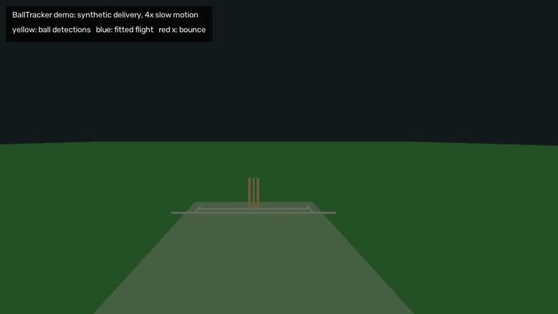
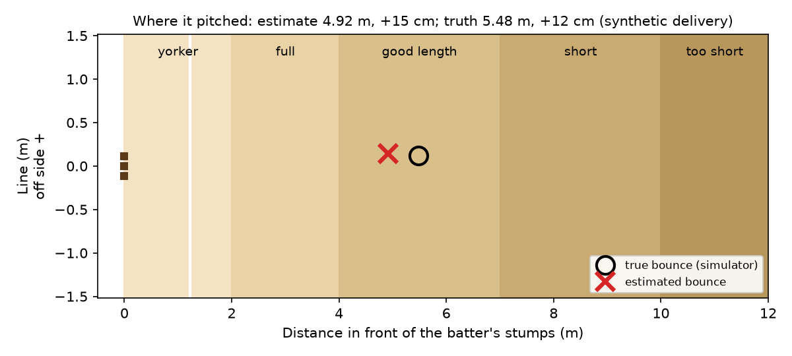

# BallTracker

[](https://github.com/TeleVision05/ball-tracker/actions/workflows/ci.yml)

BallTracker measures a cricket delivery from a video filmed behind the bowler's stumps: it calibrates the camera from the stumps, tracks the ball, fits its flight before and after the bounce, and reports release speed, where the ball pitched and how much it turned. It is a research prototype, and its accuracy has been measured on synthetic deliveries only.

<p align="center">
  
</p>
<p align="center">
  
</p>

Both images come from `balltracker demo`: a simulated 134 km/h delivery, measured by the same code that analyses a real clip, with the simulator's truth alongside.

## Try it in five minutes

You need Python 3.11 or 3.12 and git. ffmpeg is optional: without it the demo still runs, but its overlay video is in a format some browsers will not play.

```bash
git clone https://github.com/TeleVision05/ball-tracker.git
cd ball-tracker
python3.12 -m venv .venv        # or python3.11
source .venv/bin/activate       # Windows: .venv\Scripts\activate
pip install -e ".[dev]"
balltracker demo                # or: python -m balltracker demo
```

The install pulls in OpenCV, MediaPipe and Streamlit, so it is the slow part. The demo needs no footage and no downloads, and finishes in a few seconds. It:

1. simulates one delivery and renders it as a 1920x1080, 120 fps clip from behind the bowler;
2. calibrates the camera by PnP on the stumps, with click error added as if a person had clicked them;
3. calls `pipeline.analyze_delivery`, the function behind `scripts/analyze_delivery.py`, on that clip: colour tracking of the red ball, the bounce-segmented fit and the metrics;
4. prints each estimate next to the simulator's truth and writes `out/demo/`:

| File | What it is |
|---|---|
| `overlay.mp4` | the clip in 4x slow motion with the detections, the fitted flight and the bounce, then the results |
| `pitch_map.png` | where the ball pitched: estimate against truth |
| `summary.json` | truth, estimate and error for each metric, with calibration and tracking details |
| `delivery.mp4`, `session.calib.json`, `demo_config.yaml`, `analysis.json` | the clip, calibration and settings it used and the raw analysis, so you can rerun the CLI on them |

The estimates are not exact. In the run shown above the speed reads 142.8 km/h against a true 134.0, and the bounce is 0.56 m fuller than it was. [docs/ACCURACY.md](docs/ACCURACY.md) shows that this is typical and where the error comes from.

To measure accuracy over many synthetic deliveries, run `balltracker benchmark`. It takes about a minute and a half and rewrites `docs/ACCURACY.md`.

## Run it on your own clip

Film from about 4 m behind the bowler's stumps at 120 fps or more, with both sets of stumps fully in frame. [docs/CAPTURE_PROTOCOL.md](docs/CAPTURE_PROTOCOL.md) has the full checklist. Put clips in `data/raw/real/`, which git ignores; footage is never committed.

**Streamlit app.** Calibrate by clicking the stumps, then analyse:

```bash
streamlit run scripts/run_session_app.py
```

**Calibrate** tab: load a frame, click the stump landmarks in order, save. **Analyze** tab: run the analysis and see the pitch map and overlay.

**Command line.** The same two steps:

```bash
python scripts/calibrate_stumps.py --video data/raw/real/clip.mp4 --out data/raw/real/session.calib.json
python scripts/analyze_delivery.py --video data/raw/real/clip.mp4 --calib data/raw/real/session.calib.json --out analysis.json
```

`--method` picks the ball detector: `auto` (the default, a motion-based hybrid for nets footage), `hsv` (a red ball), `white` (a white ball) or `motion`. On first use `auto` downloads a 5.5 MB MediaPipe pose model into `models/` to find the release point; without a network it carries on without it.

**Android capture app** (`android/`). A Kotlin and Compose app that records high-speed clips on the phone. On the capture screen you drag four markers onto the stump bases, and the app writes a JSON sidecar next to each clip with those marks, the camera's intrinsics and the frame timestamps. Because the sidecar carries the calibration, a phone clip skips the clicking step:

```bash
python scripts/analyze_capture.py --sidecar path/to/clip.json --out analysis.json
```

The video is the `videoFile` named in the sidecar. Open `android/` in Android Studio to build the app; its unit tests run with `./gradlew :app:testDebugUnitTest`.

## Status

- **Works end to end on synthetic clips.** `balltracker demo` and the test suite run calibration, tracking, the fit and the metrics on rendered deliveries, and CI runs the tests, lint and builds on every pull request and push to `main`.
- **Accuracy is synthetic only.** Over 500 simulated deliveries with phone-like detection noise, the median error is 7.9 km/h for release speed, 2 cm for line and 94 cm for length ([docs/ACCURACY.md](docs/ACCURACY.md)). No real delivery has been checked against radar or a marked bounce yet; that is milestone M2 in [ROADMAP.md](ROADMAP.md).
- **Not yet working on real footage.** No phone capture from the Android app has been analysed yet. On the only real clips available (two 24 fps stock clips of net practice), 26 runs gave no believable speed or bounce ([docs/REAL_FOOTAGE.md](docs/REAL_FOOTAGE.md), 2026-11-13). Every result now carries plain-language checks: read the `Check this result:` lines (or the app's warnings) before the numbers.
- **Known gaps.** Swing is not estimated (it always reads 0°). The tracker's outlier filter drops the frames around the bounce, which is the largest single source of speed and length error in the benchmark.
- **BallTrace** (a separate, local-first experiment that detects the ball with an Ollama vision model) lives in [`balltrace/`](balltrace/README.md) with its own README. It needs Node.js 18+, [Ollama](https://ollama.com) with `qwen3-vl:8b`, and optionally FFmpeg.

## Configure

There is no `.env` file. The only environment variables are the optional BallTrace backend ones (`BALLTRACE_HOST`, `BALLTRACE_PORT`, `BALLTRACE_MAX_UPLOAD_MB`), documented in [`balltrace/README.md`](balltrace/README.md).

- Pitch geometry, camera, detection and physics parameters: [`config/default.yaml`](config/default.yaml)
- BallTrace backend constants (Ollama URL, model, frame stride, timeouts): [`balltrace/backend/app/config.py`](balltrace/backend/app/config.py); Ollama URL and model can also be changed in the UI Settings panel and are stored in SQLite.

`pip install -e ".[dev]"` (an editable install with the `dev` extra) is the only install path. `requirements.txt` points at it, and `pyproject.toml` holds every dependency and version bound. To run the commit checks locally, install the hooks once with `pre-commit install`. They run ruff (check and format) on all Python and oxlint on `balltrace/frontend`; `pre-commit run --all-files` runs them on everything. The frontend hook needs `npm ci` in `balltrace/frontend` first.

## Test

```bash
pytest tests/ -q                                 # analytics package, demo and benchmark
cd balltrace/backend && pytest -q                # BallTrace backend
cd balltrace/frontend && npm run lint && npm test && npm run build
ruff check . && ruff format --check .
```

No footage is needed: the tests render synthetic deliveries. `tests/test_benchmark.py` runs a small seeded benchmark and fails if the fit's errors grow past fixed bounds. Backend tests need no Ollama, ffmpeg or video file.

## Method (v1)

1. Stump-anchored camera pose (PnP) in world pitch coordinates
2. Ball detect and track (HSV / motion / hybrid with optional MediaPipe release seed and CSRT)
3. Bounce-segmented gravity fit (optional drag) with reprojection and ray distance
4. Metrics: release speed, swing, post-bounce turn, pitch line/length

`src/balltracker/synthetic.py` simulates deliveries; `scenario.py` aims them at a chosen line and length for the demo and the benchmark.

## Layout

```
config/default.yaml        pitch, camera, detection, physics, paths
docs/                      CAPTURE_PROTOCOL.md, GROUND_TRUTH.md, ACCURACY.md, media/
data/ground_truth/         label schema and CSV template
scripts/                   calibrate_stumps.py, analyze_delivery.py, analyze_capture.py, run_session_app.py
src/balltracker/           package source; cli.py is the balltracker command, app/ is the Streamlit app
tests/                     pytest suite
android/                   capture app (Kotlin, Compose)
balltrace/                 BallTrace backend (FastAPI) and frontend (React/Vite)
```

## License

[MIT](LICENSE), copyright 2026 Tarun Vadapalli. The licence covers the code only. Video footage and capture sessions are not part of the repository and must never be committed.
